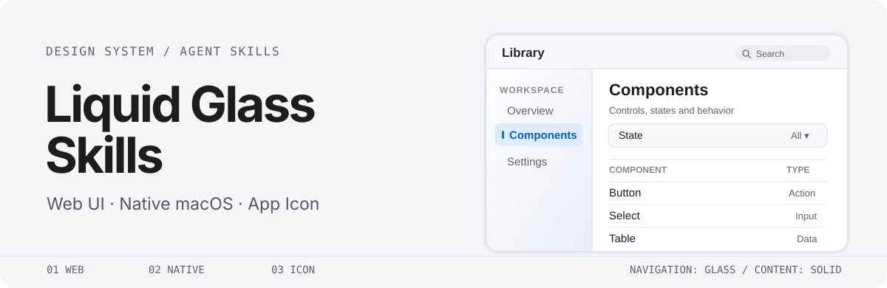

<p align="center">
  
</p>

面向 AI 编程助手的 macOS Liquid Glass 设计与实现规范。将页面结构、系统材质、组件交互和验收要求组织为三个独立的 Skill，供新项目、现有项目改造和设计审查使用。

[查看组件规范](skills/macos-liquid-glass-ui/references/component-design-contract.md) · [组件交互示例](skills/macos-liquid-glass-ui/assets/component-showcase.html) · [图标示例](assets/examples/chinese-zodiac-liquid-glass.png)

## 安装

```bash
# 查看可安装的 Skill
npx skills add Inupedia/macos-liquid-glass-ui-skill --list

# 为 Codex 和 Cursor 全局安装全部三个 Skill
npx skills add Inupedia/macos-liquid-glass-ui-skill \
  --skill '*' --agent codex cursor --global --yes
```

也可以通过 `--skill macos-liquid-glass-ui`、`--skill macos-liquid-glass-native-ui` 或 `--skill macos-liquid-glass-icon` 单独安装。全局已安装 Skill 可通过 `npx skills ls -g` 查看，使用 `npx skills update -g` 更新。

## 三个 Skill

| Skill | 用途 | 主要内容 |
| --- | --- | --- |
| [macos-liquid-glass-ui](skills/macos-liquid-glass-ui/SKILL.md) | Web、Vue / React、Electron、Tauri | 页面布局、Toolbar、Sidebar、表格、选择器、弹窗与组件状态 |
| [macos-liquid-glass-native-ui](skills/macos-liquid-glass-native-ui/SKILL.md) | SwiftUI、AppKit | 系统材质、窗口与导航、Sheet、菜单、快捷键和系统辅助功能 |
| [macos-liquid-glass-icon](skills/macos-liquid-glass-icon/SKILL.md) | macOS / iOS / iPadOS App Icon | 图标隐喻、轮廓、风格一致性与 Icon Composer 分层交付 |

Web Skill 使用浏览器可实现的材质近似；原生 Skill 优先采用 macOS 系统组件。图标设计单独处理，不套用页面控件的实现方法。

## 设计重点

核心不是让所有元素变成玻璃，而是区分内容层和功能层：Toolbar、Sidebar、Popover 可以使用适当的玻璃材质；正文、长表单、Table 和 Chart 保持稳定、可读的内容表面。

组件规范覆盖 **选型、结构、状态、键盘交互和验证**，不只是列出控件名称。

| 组件专题 | 文档 |
| --- | --- |
| Button、导航、反馈 | [Actions / Navigation / Feedback](skills/macos-liquid-glass-ui/references/actions-navigation-feedback-components.md) |
| Dialog、Sheet、Popover、Menu | [Overlays & Dialogs](skills/macos-liquid-glass-ui/references/overlays-and-dialog-components.md) |
| Select、Combobox、Segmented、输入 | [Selection & Input](skills/macos-liquid-glass-ui/references/selection-and-input-components.md) |
| Table、排序、筛选、批量操作 | [Tables & Data](skills/macos-liquid-glass-ui/references/tables-and-data-components.md) |

还包括窄窗口、短屏、滚动、200% 文字缩放、深色模式、无障碍和降低透明度设置。实现时优先保留项目现有框架、组件库与业务逻辑。

[交互式组件 Showcase](skills/macos-liquid-glass-ui/assets/component-showcase.html) · [CSS 配方](skills/macos-liquid-glass-ui/assets/component-recipes.css) · [设计 Tokens](skills/macos-liquid-glass-ui/assets/foundation.css)

克隆仓库后，可直接在浏览器打开 `component-showcase.html`，体验部分 Dialog、Select 和 Table 交互。它是零构建依赖的参考示例，并非可直接投入生产的完整组件库。

## 使用示例

```text
使用 $macos-liquid-glass-ui 审查当前项目的 macOS 风格界面。
保留现有业务和组件库，重点检查布局、Sidebar、Table、Select、Dialog、
键盘交互和 200% 文字缩放。先列出问题与验证方法，不直接改代码。
```

原生 SwiftUI / AppKit 项目改用 `$macos-liquid-glass-native-ui`；App Icon 设计使用 `$macos-liquid-glass-icon`。


## 验证与维护

```bash
python3 -m unittest discover -s tests
python3 scripts/validate_skills.py --strict
python3 scripts/run_evals.py --list
```

`SKILL.md` 负责适用场景与执行流程，详细规则放在 `references/` 按需加载。仓库提供结构校验、Evals 用例及 CI 检查；真实 Agent 的语义评分需要配置相应执行环境。详见 [Evals 文档](docs/evals.md)。

---

参考：[Apple Human Interface Guidelines](https://developer.apple.com/design/human-interface-guidelines/) · [Liquid Glass](https://developer.apple.com/documentation/technologyoverviews/liquid-glass) · [Icon Composer](https://developer.apple.com/icon-composer/)

本项目与 Apple 无隶属关系。Web 端视觉参数为本项目基线，非 Apple 官方固定值；原生行为以对应 Apple SDK 和官方文档为准。
