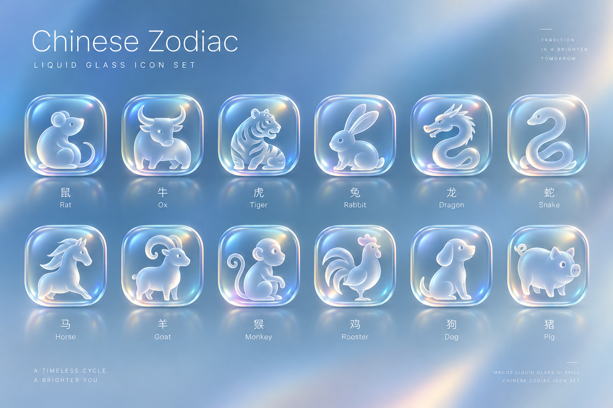

# macOS Liquid Glass Skills

[](https://skills.sh/Inupedia/macos-liquid-glass-ui-skill)

**让 AI 不只画出「玻璃感」，而是真正设计、实现并检查一套 macOS 风格的产品界面。**

为 AI Coding Agent 准备的 **3 个独立 Skills**，覆盖 Web / Electron / Tauri、原生 SwiftUI / AppKit，以及 App Icon。聚焦真实产品中的组件、交互、可访问性和交付验证，而不是一张只适合展示的效果图。

**开箱即用 · 按需加载 · 组件级规范 · 可运行示例 · Evals 校验**

> [!NOTE]
> 本项目是独立社区实践，与 Apple 无隶属关系。Web 材质是视觉近似；原生行为以 Apple SDK 和官方设计规范为准。

## ⚡ 30 秒安装

先查看仓库提供的 Skills：

```bash
npx skills add Inupedia/macos-liquid-glass-ui-skill --list
```

**推荐：为 Codex + Cursor 全局安装全部 3 个 Skill**

```bash
npx skills add Inupedia/macos-liquid-glass-ui-skill \
  --skill '*' --agent codex cursor --global --yes
```

只需要 Web UI Skill？单独安装即可：

```bash
npx skills add Inupedia/macos-liquid-glass-ui-skill --skill macos-liquid-glass-ui
```

如果希望安装到 CLI 支持的全部 Agent，可使用 `--all --global`。安装后可统一管理：

```bash
npx skills ls -g       # 查看全局 Skills
npx skills update -g   # 更新已安装的全局 Skills
```

> 新增 Skill 不一定会被 `update` 自动发现；仓库增加新 Skill 时，重新运行 `--list` 检查即可。

## ✨ 选择适合你的 Skill

| Skill | 用于 | 核心能力 |
| --- | --- | --- |
| **[macos-liquid-glass-ui](skills/macos-liquid-glass-ui/SKILL.md)** | Web、React、Vue、Electron、Tauri | 页面范式、Toolbar / Sidebar、组件、表格、弹窗、Selector、玻璃材质与响应式 |
| **[macos-liquid-glass-native-ui](skills/macos-liquid-glass-native-ui/SKILL.md)** | macOS SwiftUI / AppKit | 原生窗口、系统组件、`glassEffect`、菜单与快捷键、系统偏好适配 |
| **[macos-liquid-glass-icon](skills/macos-liquid-glass-icon/SKILL.md)** | macOS / iOS / iPadOS App Icon | 产品隐喻、统一图标家族、图像生成、Icon Composer 分层交付 |

三个 Skill 各司其职，不会把 Web 的 `backdrop-filter` 方案生搬硬套进原生 macOS，也不会把 App Icon 的玻璃风格滥用到普通工具栏图标上。

## 为什么不只是一个 UI Prompt？

- **组件真的能用**：Button、Table、Select / Combobox、Sheet / Dialog、Popover、Menu、表单、筛选、批量操作与状态反馈，覆盖外观 **和** 交互。
- **材质有边界**：Glass 优先服务导航和功能层；正文、表格、图表保留稳定、易读的内容层，避免全屏毛玻璃。
- **照顾真实场景**：窄窗口、短屏、滚动、200% 文字缩放、键盘导航、深色模式与减少透明度等系统偏好。
- **尽量复用现有项目**：优先映射既有 Token、组件库和技术栈，不为追求视觉效果重写业务架构。
- **有检查依据**：配有 CSS 示例、可运行 Showcase、Anti-patterns、验证脚本与行为 Evals。

### 组件设计，细到可落地

不只说明“要有弹窗和表格”，还描述 **Variant / Anatomy / Material / 状态 / 交互 / 验收**：

| 专题 | 查看规范 |
| --- | --- |
| 组件设计总入口 | [Component Design Contract](skills/macos-liquid-glass-ui/references/component-design-contract.md) |
| 按钮、导航和反馈 | [Actions / Navigation / Feedback](skills/macos-liquid-glass-ui/references/actions-navigation-feedback-components.md) |
| 弹窗、Sheet、Popover、Menu | [Overlays & Dialogs](skills/macos-liquid-glass-ui/references/overlays-and-dialog-components.md) |
| Select、Combobox、Segmented、输入 | [Selection & Input](skills/macos-liquid-glass-ui/references/selection-and-input-components.md) |
| Table、Sort、Filter、Selection | [Tables & Data](skills/macos-liquid-glass-ui/references/tables-and-data-components.md) |

**[查看可运行组件 Showcase](skills/macos-liquid-glass-ui/assets/component-showcase.html)** · [CSS 组件配方](skills/macos-liquid-glass-ui/assets/component-recipes.css) · [基础设计 Tokens](skills/macos-liquid-glass-ui/assets/foundation.css)

将仓库克隆到本地后，直接用浏览器打开 `component-showcase.html`，即可体验部分 Dialog、Select 和 Table 交互；它是零构建依赖的演示，不是完整的生产组件库。

## 💬 直接这样对 Agent 说

**改造现有 Web 项目**

```text
使用 $macos-liquid-glass-ui 改造当前 Vue / React 项目。
保留原有组件库与业务逻辑，优先完善布局、Toolbar、Sidebar、
弹窗、Selector、Table 的组件状态和交互，并验证短屏与无障碍体验。
```

**实现原生 macOS 界面**

```text
使用 $macos-liquid-glass-native-ui 完善当前 SwiftUI macOS App。
优先使用系统 Toolbar、Sidebar、Sheet、Menu 和 Liquid Glass API，
避免重复手绘玻璃材质，并检查窗口缩放与系统辅助功能设置。
```

**生成 App Icon**

```text
使用 $macos-liquid-glass-icon 为当前产品设计 Liquid Glass App Icon。
先确定产品隐喻、轮廓和图层，再生成候选稿，
检查 64/32px 识别度，并给出 Icon Composer 分层交付说明。
```

### 图标效果示例



*用于验证同一图标家族的材质、配色与轮廓一致性。AI 生成图片是视觉稿，正式 App Icon 仍需使用 Icon Composer / Xcode 验证。*

## 🧪 可维护，也可验证

本仓库把入口与详细知识分离：`SKILL.md` 负责识别任务、确定流程和按需引用 `references/`，无需每次都加载整套设计规范。

```bash
python3 -m unittest discover -s tests
python3 scripts/validate_skills.py --strict
python3 scripts/run_evals.py --list
```

- **静态校验**：检查 Skill 结构、引用、Tokens 和 Evals 数据，CI 持续运行。
- **行为 Evals**：覆盖 Web / Native / Icon 路由、反例与验收规则；连接自己的 Agent 后可执行评分与回归测试。
- **详细说明**：[Evals & 评分](docs/evals.md) · [Web 验收](skills/macos-liquid-glass-ui/references/validation.md) · [Native 验收](skills/macos-liquid-glass-native-ui/references/validation.md)

## 📚 参考

[Apple Human Interface Guidelines](https://developer.apple.com/design/human-interface-guidelines/) · [Liquid Glass](https://developer.apple.com/documentation/technologyoverviews/liquid-glass) · [Icon Composer](https://developer.apple.com/icon-composer/) · [skills.sh](https://skills.sh/)

---

**目标不是让每个界面都变成玻璃，而是让合适的产品以正确的方式使用 Liquid Glass。**
